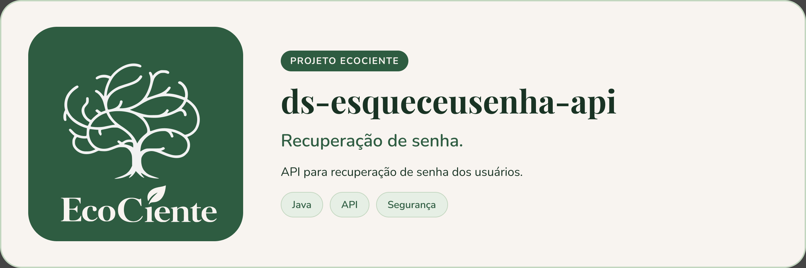

<p align="center">
  
</p>

# Esqueceu Senha API (ds-esqueceusenha-api)


> API do EcoCiente para recuperação e alteração de senha: envia um código por e-mail, redefine a senha e mantém o Firebase sincronizado.

## Sobre o projeto

Serviço Spring Boot organizado em camadas (`core`, `dataprovaider`, `entrypoint`, `config`). Todos os endpoints ficam sob `/senhas`:

| Método | Rota | Autenticação | O que faz |
| --- | --- | --- | --- |
| `POST` | `/senhas/esqueceu` | Pública | Gera um código de 4 dígitos válido por 15 minutos e envia por e-mail. Responde igual exista ou não o e-mail |
| `POST` | `/senhas/redefinir` | Pública | Recebe e-mail, código, nova senha e confirmação e redefine a senha |
| `POST` | `/senhas/alterar` | JWT (Bearer) | Altera a senha do usuário autenticado, conferindo a senha atual |

Regras da nova senha: 8 a 100 caracteres, com maiúscula, minúscula, número e caractere especial, sem espaços. A senha é gravada com BCrypt no PostgreSQL e também atualizada no Firebase. Os códigos de recuperação são guardados apenas como hash, em `tb_esqueci_senha`.

A documentação OpenAPI (springdoc) fica em `/swagger-ui.html`.

### Fluxo de recuperação

```mermaid
sequenceDiagram
    actor U as Usuário
    participant API as SenhaController
    participant S as SenhaService
    participant DB as PostgreSQL
    participant M as E-mail (SMTP)
    participant F as Firebase

    U->>API: POST /senhas/esqueceu (e-mail)
    API->>S: solicitarRecuperacao
    S->>DB: invalida pendentes e salva hash do código (15 min)
    S->>M: envia código de 4 dígitos
    U->>API: POST /senhas/redefinir (e-mail, código, nova senha)
    API->>S: redefinirSenha
    S->>DB: confere hash, validade e uso; atualiza senha (BCrypt)
    S->>F: atualiza a senha
    S->>DB: marca o código como utilizado
    API-->>U: 200 (processadoEm)
```

## Pré-requisitos

- JDK 19 (o CI e o Dockerfile usam 19)
- PostgreSQL com as tabelas de usuário e `tb_esqueci_senha` (o Hibernate roda em `validate` por padrão e não cria o schema)
- Conta de serviço do Firebase e servidor SMTP
- Docker (opcional)

## Instalando

```bash
git clone https://github.com/EcoCiente-Instituto-J-F/ds-esqueceusenha-api.git
cd ds-esqueceusenha-api
cp .env.example .env      # Windows (PowerShell): Copy-Item .env.example .env
```

O `application.properties` importa o arquivo `.env` (se existir). Variáveis lidas pela aplicação:

| Variável | Padrão | Descrição |
| --- | --- | --- |
| `DB_URL`, `DB_USER`, `DB_PASSWORD` | — | Conexão PostgreSQL |
| `JWT_SECRET` | — | Segredo HMAC usado para validar o JWT |
| `FIREBASE_CREDENCIAIS` | — | Credenciais do Firebase Admin |
| `URL_REDEFINICAO_SENHA` | — | URL de redefinição usada pelo e-mail |
| `MAIL_FROM`, `MAIL_HOST`, `MAIL_USERNAME`, `MAIL_PASSWORD` | — | Envio de e-mail |
| `MAIL_PORT` | `587` | Porta SMTP (STARTTLS obrigatório) |
| `PORT` | `9809` | Porta HTTP local |
| `DDL_AUTO` | `validate` | Modo do Hibernate |
| `SHOW_SQL` | `false` | Log das queries |
| `APP_PORT` | `8080` | Porta publicada pelo Docker Compose |

> O `.env.example` hoje contém apenas `APP_PORT`; as demais variáveis precisam ser definidas por você.

## Usando

```bash
./gradlew bootRun            # Windows: .\gradlew.bat bootRun
docker compose up --build    # publica em http://localhost:${APP_PORT:-8080}
```

## Testes

```bash
./gradlew clean build --no-daemon   # mesmo comando do CI
```

Há testes de serviço, controller, mappers e tratamento de exceções em `src/test/java`.

## Estrutura do projeto

```
src/main/java/br/com/ecociente/senha/
├── config/            # security (JWT, SecurityConfig) e firebase
├── core/              # domain, exception, gateway (interfaces) e service
├── dataprovaider/     # entity, repository, mapper e implementações dos gateways
└── entrypoint/        # controller, dto e ApiExceptionHandler
```

O CI (`.github/workflows/ci.yml`) roda build e testes, publica a imagem `ecociente/ecociente:esqueceusenha-VERSAO` (tag imutável, versão do `build.gradle`) e solicita a atualização da infraestrutura em `devops-infra-ecociente`.

## Contribuindo

Leia o [CONTRIBUTING.md](CONTRIBUTING.md) antes de abrir uma Pull Request. Ao participar, você concorda com o [Código de Conduta](CODE_OF_CONDUCT.md).

## Segurança

Encontrou uma vulnerabilidade? Siga o [SECURITY.md](SECURITY.md). **Não abra issue pública.**

## Licença

Este projeto está sob a licença MIT. Veja o arquivo [LICENSE](LICENSE).
